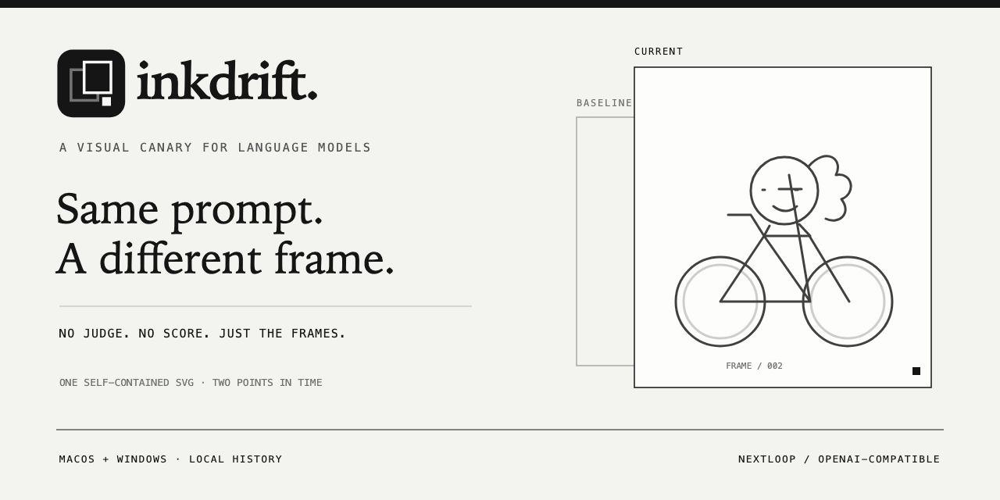
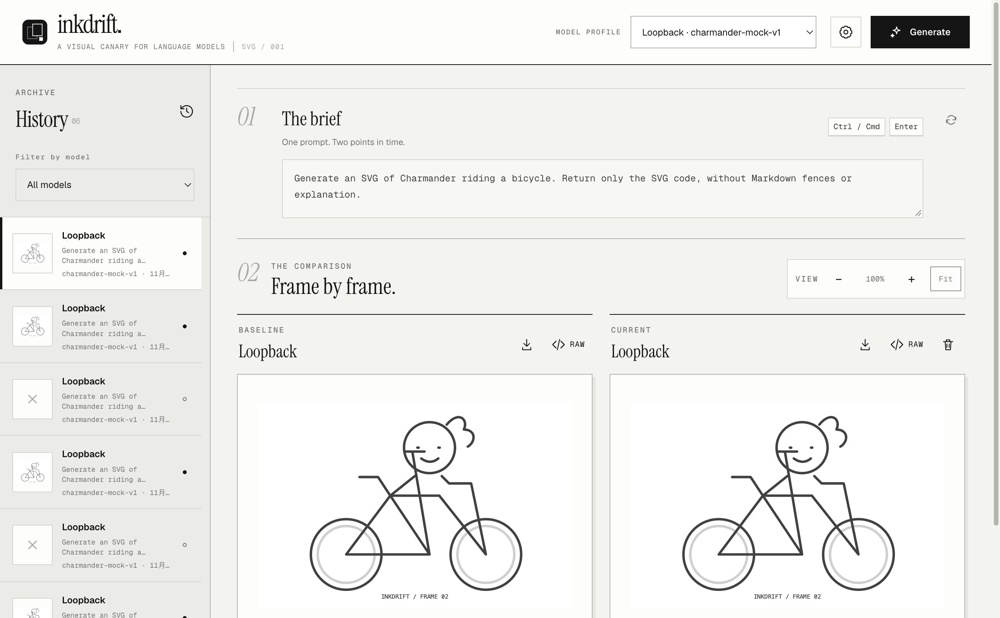

<div align="center">
  
  <h1>Inkdrift</h1>
  <p><strong>A visual canary for language models.</strong></p>
  <p>One prompt. Two points in time. No score — just the frames.</p>
  <p>
    <a href="https://github.com/12bitsD/inkdrift/actions/workflows/build.yml">Download a build</a> ·
    <a href="#quick-start">Quick start</a> ·
    <a href="#how-it-works">How it works</a> ·
    <a href="CONTRIBUTING.md">Contribute</a>
  </p>
  <p>
    <a href="https://github.com/12bitsD/inkdrift/actions/workflows/build.yml"></a>
    
    
    <a href="LICENSE"></a>
  </p>
</div>

<br>

Inkdrift is a small desktop workbench for spotting visual drift in a model's SVG output. Keep a good result as the **Baseline**, run the same brief again, and inspect the **Current** frame side by side — with a local history of every attempt.

It is a canary, not a verdict. Inkdrift does not assign an IQ score, rank models, or declare a model degraded from a single drawing.



## A small instrument, not a benchmark

<table>
  <tr>
    <td width="33%" valign="top">
      <br>
      <strong>Compare, don't score.</strong>
      <p>Explicit Baselines, synchronized zoom, SVG export, and raw responses. You inspect the evidence; Inkdrift does not invent a grade.</p>
    </td>
    <td width="33%" valign="top">
      <br>
      <strong>Keep the frames.</strong>
      <p>Model, prompt, timestamp, duration, token usage, and failures stay in a searchable local History. Load older frames only when you need them.</p>
    </td>
    <td width="33%" valign="top">
      <br>
      <strong>Local by design.</strong>
      <p>API keys use macOS Keychain or Windows DPAPI. Generated SVG is sanitized and rendered under a restrictive CSP. No account is required.</p>
    </td>
  </tr>
</table>

## Quick start

### Download

Open [**Actions → latest successful build**](https://github.com/12bitsD/inkdrift/actions/workflows/build.yml) and download the artifact for your platform:

| Platform | Artifact | Package |
| --- | --- | --- |
| macOS Apple Silicon | `inkdrift-macos-universal` | arm64 ZIP |
| macOS Intel | `inkdrift-macos-universal` | x64 ZIP |
| Windows x64 | `inkdrift-windows-x64` | NSIS installer |

Builds are currently unsigned and not notarized. Only download artifacts from this repository's own Actions runs.

### Configure a model

Open **Settings → Model profiles** and add:

1. A display name.
2. An OpenAI-compatible Base URL, such as `https://api.openai.com/v1`.
3. The exact model ID and provider API key.
4. Timeout and maximum output tokens.

HTTPS is required for remote providers. Loopback HTTP is available for local development. Prompts and responses go to the provider you configure; **local app** describes storage, not local inference.

### Run the canary

The default brief is intentionally simple:

```text
Generate an SVG of Charmander riding a bicycle. Return only the SVG code, without Markdown fences or explanation.
```

Generate once. When you get a useful reference frame, choose **Set as baseline**. Generate again later and compare.

<table>
  <tr>
    <td><code>Cmd / Ctrl + Enter</code></td>
    <td>Generate a new frame</td>
    <td><code>↑ / ↓</code></td>
    <td>Move through History</td>
  </tr>
  <tr>
    <td><code>Cmd / Ctrl + B</code></td>
    <td>Set the current frame as Baseline</td>
    <td><code>Esc</code></td>
    <td>Close the active dialog or History drawer</td>
  </tr>
</table>

Baselines are scoped by **model profile + prompt hash**. Generating never replaces a Baseline, and an old frame cannot be assigned to a different prompt by accident.

## How it works

```text
React renderer · sandboxed, no Node integration
  │ typed IPC · no API key
Electron main
  ├─ safeStorage + local files
  └─ one Python worker per generation
       └─ nextloop==1.0.0 · AgentLoop + OpenAIProvider
            └─ OpenAI-compatible /chat/completions
```

Each generation is one Nextloop turn with one model call, no tools, no automatic retries, and no persistent agent session. SVG output is bounded and sanitized to remove scripts, event handlers, external resources, navigation, XML doctypes/entities, and other active content.

History thumbnails read only the SVG payload, not the full raw response. The initial view renders 50 records and loads older records in batches, keeping startup work bounded as the archive grows.

### Local data

Electron stores data in the platform-specific `userData` directory:

- macOS: `~/Library/Application Support/inkdrift/`
- Windows: `%APPDATA%/inkdrift/`

`settings.json` contains encrypted credentials, never plaintext API keys. `history/` contains metadata, raw responses, and sanitized SVGs. `baselines.json` stores explicit Baseline selections. JSON writes use temporary files and atomic renames; failed run writes clean up their partial files.

## Development

Requirements: **Node.js 22+**, **pnpm 12.5.1**, **Python 3.11**.

```bash
pnpm install
python3.11 -m venv .venv
.venv/bin/python -m pip install -e 'worker[dev,build]'
# Windows: .venv/Scripts/python -m pip install -e 'worker[dev,build]'
pnpm dev
```

<details>
  <summary><strong>Checks and packaging</strong></summary>

  <br>

  ```bash
  pnpm lint
  pnpm typecheck
  pnpm build
  pnpm peers check
  .venv/bin/python -m mypy worker/src
  .venv/bin/python -m ruff check worker
  .venv/bin/python -m ruff format --check worker
  ```

  Build the desktop package for the current OS:

  ```bash
  pnpm dist
  ```

  PyInstaller does not provide a general cross-platform worker build, so macOS and Windows packages are built on their own runners. CI uploads only the final ZIP / installer, not duplicate unpacked application directories.

</details>

## Boundaries

- No quality score, LLM judge, model ranking, scheduled monitoring, or trend analysis.
- No multi-step agent, tool use, persistent Nextloop event store, web server, or account system.
- No claim that one SVG represents general model intelligence.
- Mock-provider checks validate the application and Nextloop execution path, never external model quality.

## License

Inkdrift is available under the [MIT License](LICENSE). Geist, Geist Mono, and Instrument Serif are distributed under the SIL Open Font License; their notices are included in `public/licenses/`.

## Community

- [Contributing guide](CONTRIBUTING.md)
- [Report a bug](https://github.com/12bitsD/inkdrift/issues/new?template=bug_report.yml)
- [Suggest an improvement](https://github.com/12bitsD/inkdrift/issues/new?template=feature_request.yml)
- [Security policy](SECURITY.md)
- [Code of conduct](CODE_OF_CONDUCT.md)

<br>

<div align="center">
  <br>
  <code>TWO FRAMES. ONE SIGNAL.</code>
</div>
